 

&nbsp;
&nbsp;

 

 

 

 

 

<picture>
  <source media="(prefers-color-scheme: dark)" srcset="./metrics/snake-dark.svg">
  <source media="(prefers-color-scheme: light)" srcset="./metrics/snake-light.svg">
  
</picture>

 

 

