

<a href="https://alokchaudhary.me"></a>

 

<a href="https://alokchaudhary.me"></a>&nbsp;
<a href="https://www.linkedin.com/in/alokkchaudharyy"></a>&nbsp;
&nbsp;

 


 


<a href="https://alokchaudhary.me"></a>

<a href="https://github.com/alokkkchaudharyyy/agent-bridge"></a>
<a href="https://nexeraofficial.in"></a>
<a href="https://github.com/ArunmehtaBuild/NetWM"></a>

 

<a href="https://nexeraofficial.in"></a>

 


 


 


<picture>
  <source media="(prefers-color-scheme: dark)" srcset="./metrics/snake-dark.svg">
  <source media="(prefers-color-scheme: light)" srcset="./metrics/snake-light.svg">
  
</picture>

 


